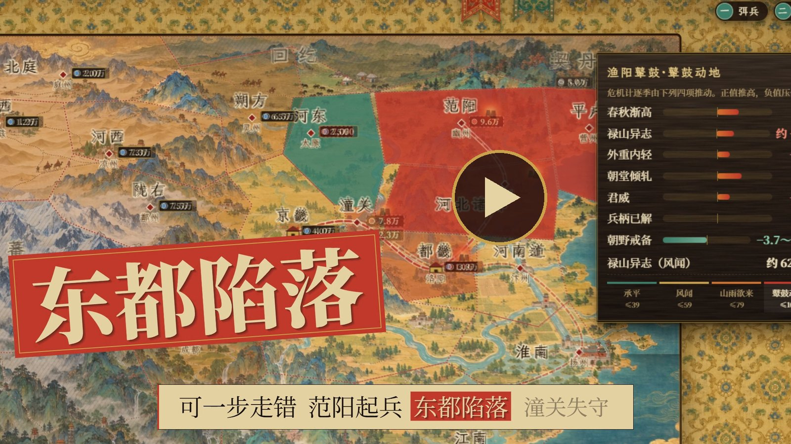
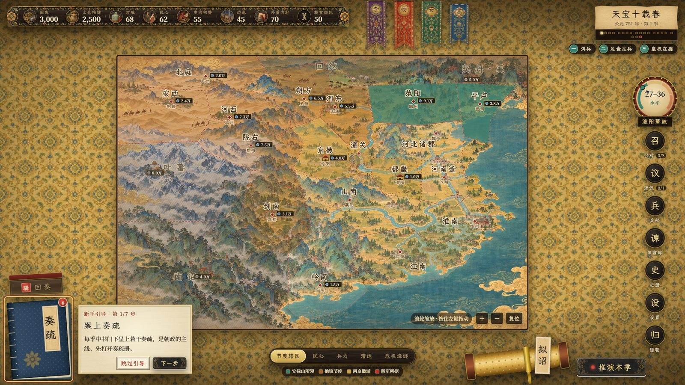
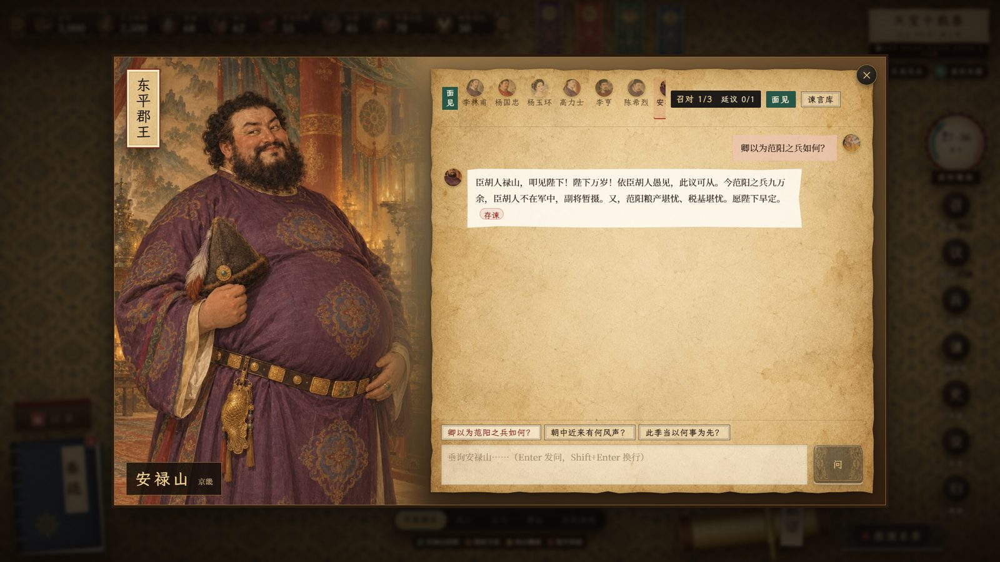
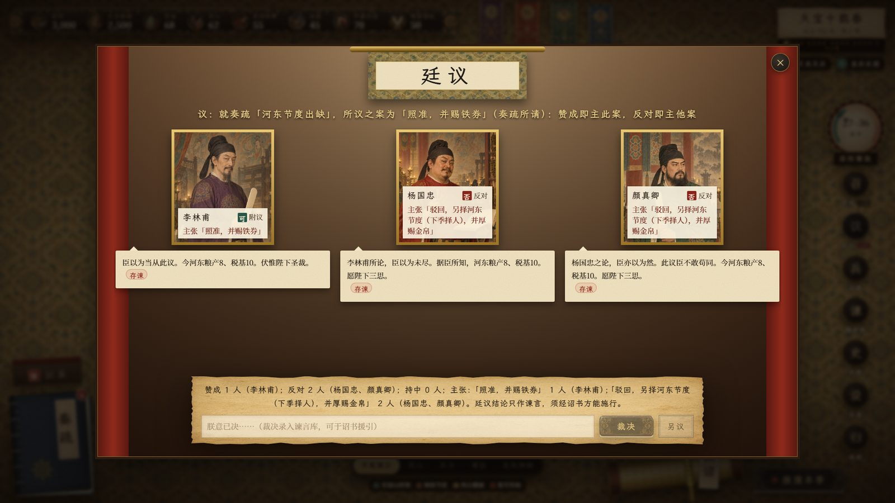
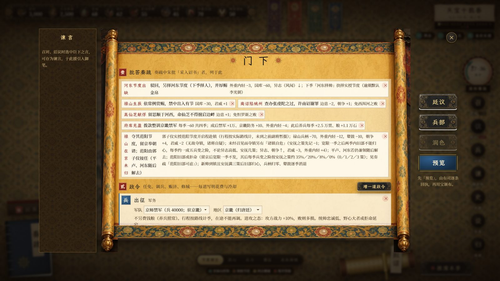
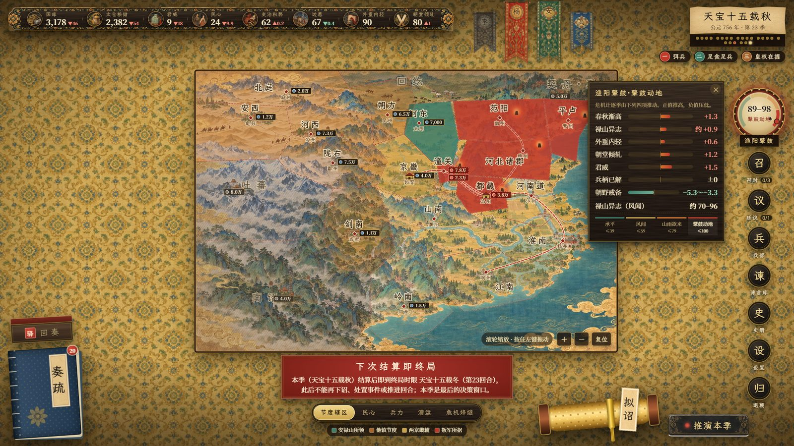
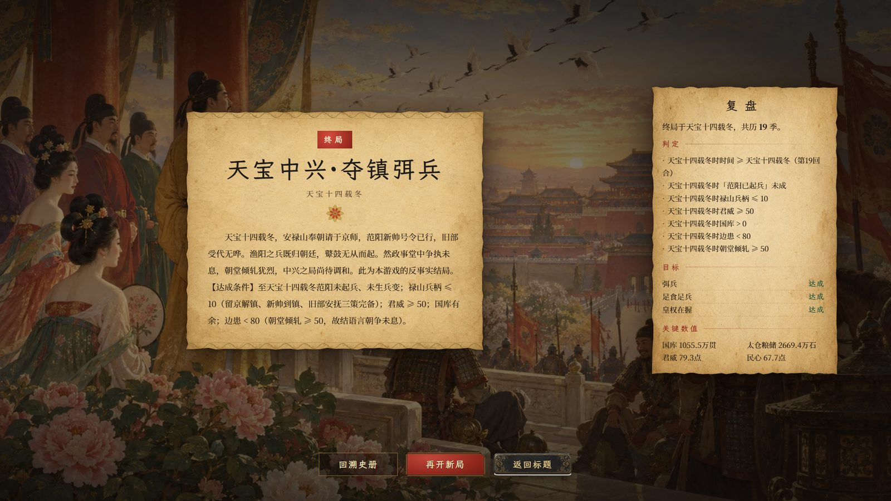
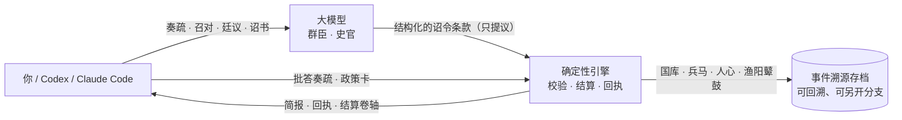

<p align="center">
  
</p>

<h1 align="center">天宝</h1>

<p align="center">
  <b>盛世只剩最后四年。你能阻止安史之乱吗？</b><br>
  一款 AI 驱动的历史模拟：你是天宝十载（公元 751 年）的唐玄宗，满朝文武由大模型扮演。
</p>

<p align="center">
  <a href="LICENSE"></a>
  
  
  
  <a href="#-宣传片"></a>
</p>

<p align="center">
  <a href="https://github.com/Yi-111-a/tianbao/releases/download/v0.1.0/tianbao_0.1.0_x64-setup.exe"></a>
  <br><sub>60.6 MB · 无需管理员权限 · 不配模型也能玩 · <a href="https://github.com/Yi-111-a/tianbao/releases/tag/v0.1.0">发布说明</a></sub>
</p>

---

## 🎬 宣传片

<table>
  <tr>
    <td width="74%" align="center">
      <a href="https://github.com/Yi-111-a/tianbao/releases/download/v0.1.0/tianbao-promo-16x9.mp4"></a><br>
      <sub>横屏 1920×1080 · 59 秒 · <a href="https://github.com/Yi-111-a/tianbao/releases/download/v0.1.0/tianbao-promo-16x9.mp4">下载 / 播放</a></sub>
    </td>
    <td width="26%" align="center">
      <a href="https://github.com/Yi-111-a/tianbao/releases/download/v0.1.0/tianbao-promo-9x16.mp4"></a><br>
      <sub>竖屏 1080×1920 · <a href="https://github.com/Yi-111-a/tianbao/releases/download/v0.1.0/tianbao-promo-9x16.mp4">下载 / 播放</a></sub>
    </td>
  </tr>
</table>

画面全部来自真实对局。视频与安装包一起放在 [v0.1.0 发布页](https://github.com/Yi-111-a/tianbao/releases/tag/v0.1.0)。

## 这是什么游戏

天宝十载春，范阳、平卢两镇在安禄山手里，杨国忠正在上位，长安一派繁华。照史书走下去，四年后渔阳鼙鼓动地来，潼关失守，车驾西幸，马嵬驿前六军不发。

这一次，皇位交给你。每一季你读奏疏、召见大臣、开廷议、拟诏书、调兵遣将，然后看天下如何回应。

- **大臣会说话**：召对和廷议里，每位大臣都由大模型按人设扮演，会附议、会反对、会替自己打算。没有配置模型也能玩，大臣改用离线文本应对。
- **数字不靠模型编**：国库、粮储、兵马、人心、渔阳鼙鼓（叛乱危机计）由确定性引擎结算。每道诏令都有回执：哪条即刻施行，哪条要等驿马送到。
- **天下很大**：几千里外的奏报会迟到，大军赴任要走好几季，不在京的大臣只能递书面议状。
- **历史会抵抗你**：147 个事件、185 道奏疏、27 张政策卡、18 种结局，分演义 / 史实 / 地狱三档难度。什么都不做时，史实难度下约九成的局会重演安史之乱。

## 游戏画面

<table>
  <tr>
    <td width="50%"><br><sub><b>御案</b>：舆图、势力绸带、渔阳鼙鼓危机计</sub></td>
    <td width="50%"><br><sub><b>召对</b>：当面问安禄山，范阳的兵到底听谁的</sub></td>
  </tr>
  <tr>
    <td><br><sub><b>廷议</b>：谁附议、谁反对、各自主张哪一案</sub></td>
    <td><br><sub><b>拟诏</b>：采纳奏疏、加政策卡，颁布前先看回执</sub></td>
  </tr>
  <tr>
    <td><br><sub><b>一步走错</b>：范阳起兵，叛军逐季南下</sub></td>
    <td><br><sub><b>结局</b>：天宝中兴，或者渔阳鼙鼓·历史重演</sub></td>
  </tr>
</table>

## 怎么玩

### 桌面版（Windows，推荐）

1. 下载 [`tianbao_0.1.0_x64-setup.exe`](https://github.com/Yi-111-a/tianbao/releases/download/v0.1.0/tianbao_0.1.0_x64-setup.exe)（[发布说明](https://github.com/Yi-111-a/tianbao/releases/tag/v0.1.0)）。
2. 双击安装：装到当前用户（`%LOCALAPPDATA%\天宝`），不需要管理员权限。安装包没有代码签名，Windows 若弹出 SmartScreen，点「更多信息」→「仍要运行」。
3. 打开「天宝」，点「开始新局」。存档在 `%APPDATA%\tianbao`。

游戏本身不需要联网，不配模型也能完整玩一局；想让大臣由大模型扮演，在「设置 · 模型路由」里填任意 OpenAI 兼容接口。

### 在 Codex / Claude Code 里玩

游戏自带 MCP 服务，模型可以直接开局、读简报、召对、下诏、结算回合，和桌面版共用存档：你开的局模型能接着玩，反过来也一样。

装好桌面版后，一条命令把它注册给 Codex 或 Claude Code：

```powershell
powershell -NoProfile -ExecutionPolicy Bypass -File "$env:LOCALAPPDATA\天宝\integrations\setup_mcp.ps1" -Codex -Claude
```

不带 `-Codex` / `-Claude` 时只打印命令、不改任何配置；从源码运行时在仓库里执行 `integrations\setup_mcp.ps1 -Source`。手动命令、Claude Code 插件（「上朝」技能）和 Codex 说明见 [integrations/README.md](integrations/README.md)。

### 网页版（从源码运行）

需要 Python 3.11+ 和 Node.js 18+。

```powershell
git clone --recursive https://github.com/Yi-111-a/tianbao.git
cd tianbao
python -m venv .venv
.venv\Scripts\pip install -e "engine/backend[dev]"
npm --prefix app install
```

开两个终端，一个起引擎、一个起前端：

```powershell
.venv\Scripts\python scripts/dev_backend.py      # 引擎 API，默认 http://127.0.0.1:8765
npm --prefix app run dev                          # 打开 http://localhost:5173
```

想让大臣由大模型扮演，在游戏「设置 · 模型路由」里选「Claude（本机）」或「Codex（本机）」——直接用你电脑上已登录的 Claude Code / Codex，不需要 API key（第一次先点「测试连接」；Claude 未登录时在终端运行 `claude auth login`）；也可以填任意 OpenAI 兼容接口。不接模型也能完整玩一局。

## 它是怎么做的



- 引擎来自模板仓库 [llm-sim-game-template](https://github.com/Yi-111-a/llm-sim-game-template)（`engine/` 子模块）：模型只能提议带类型的状态变更，引擎校验权限、结算数值、写回执；存档是事件流，可以回溯、另开分支。
- 剧本在 [`scenarios/tianbao_751/`](scenarios/tianbao_751)，全部是 YAML：人物、地区、军队、事件、奏疏、政策卡、结局。
- 前端是 React + Vite，美术为剧本自带插画。

## 文档

| 文档 | 内容 |
|---|---|
| [docs/GAME_PLAN.md](docs/GAME_PLAN.md) | 设计计划与玩法 |
| [docs/TIANBAO_751_OUTLINE.md](docs/TIANBAO_751_OUTLINE.md) | 剧本大纲 |
| [docs/FACT_CHECK.md](docs/FACT_CHECK.md) | 史实核对 |
| [docs/CONTRACT.md](docs/CONTRACT.md) | 引擎与前端的接口契约 |
| [docs/ITERATION_LOG.md](docs/ITERATION_LOG.md) | 每一轮试玩发现的问题与修复（含 Claude 与 GPT 的对局记录） |
| [integrations/README.md](integrations/README.md) | 接入 Codex / Claude Code |

## 许可

[MIT](LICENSE)。剧本为历史题材的再创作，标注「反事实」或「本游戏设定」的内容并非史实。
